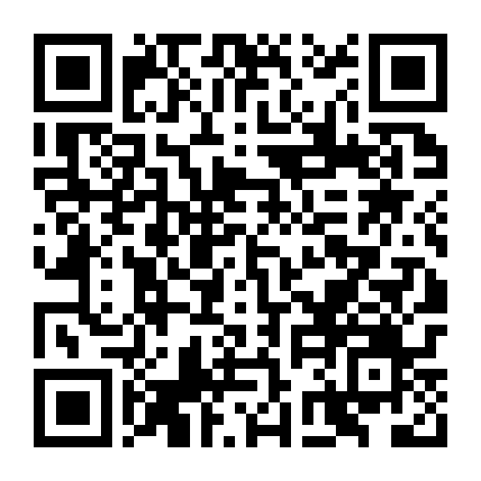

# 空飛ぶ仏像

**お金を吸い込め！仏の力で天まで昇れ！**

仏像が賽銭・小判・硬貨を吸い込み、そのエネルギー（法力）で天へ昇っていく 3D ブラウザゲームです（スマホ・PC 両対応）。

- 公開ページ：https://techgymjp.github.io/buddha/
- 日本語 / English 対応（端末の言語で自動選択。タイトル画面のボタンか `?lang=en` / `?lang=ja` で切り替え）
- ローカルで遊ぶ場合は ES モジュールを使うため、簡易サーバー経由で開いてください（例：`python3 -m http.server` → http://localhost:8000/）。

## 遊び方

| 操作 | スマホ | PC |
| --- | --- | --- |
| 左右移動 | 画面を左右にスワイプ（移動する方向へ仏像が向きを変える） | ← → / A D（マウスのドラッグも可） |
| 一時停止 | Ⅱ ボタン | P / Esc |
| 音のオン・オフ | タイトル・一時停止画面の ♪ ボタン | M |

操作は左右の移動だけです。硬貨は**自動で吸い込みます**。ゲームは賽銭鉢の上から地面を蹴ってジャンプして始まります。

- 硬貨は**仏像の上に道のように連なって**います（うねる道・らせん・ジグザグ・分かれ道・途切れ）。仏像の真上には常に吸い込みの渦があり、その範囲に入った硬貨を頭上へ引き寄せます。左右に動いて道の真下に入りましょう。
- 吸った硬貨のエネルギーで**上へ加速**します。吸った瞬間に仏像がグッと押し上げられ、連続で吸うほど加速が強くなります。左右に動いて硬貨の道をたどりましょう。
- 仏像は**重力**と、硬貨を吸ったときに働く**逆重力**、カラスを踏んだときの**反発**で動きます（空気抵抗もあり）。高度はこの物理の結果そのものです。
- 硬貨を取らないと重力で落ちていきます。カメラは上昇はしっかり追いますが、落下はゆっくりしか追わないので、落ちると画面の下へ沈み、**画面の下まで落ちるか地面に落ちたらゲームオーバー**です。沈みかけると画面の縁が赤く脈打ち、心音が鳴ります。
- カラスは決まった高度を、画面の端から端まで横切って飛びます。落ちながら**上から踏みつける**と撃ち落とし、仏像はジャンプして浮力を得ます。**横からぶつかると即アウト**です（御利益中・大仏変身中は追い払えます）。
- **到達した高度を競うゲーム**です。ステージクリアはなく、ある高度まで昇ると、止まらずにそのまま次のステージ（景色）に変わります。極楽浄土の先は終わりなく続きます。

## お寺（遊ぶたびに成長）

集めた賽銭はゲームオーバー後も「お寺の財布」に貯まります。タイトル画面の「お寺」から順に寄進すると、境内に建物が建ち、永続的な強化と新しい仏像が手に入ります。

| 建物 | 寄進 | 強化 |
| --- | --- | --- |
| 山門 | ¥9,000 | 吸引範囲アップ・達磨を解放 |
| 灯籠の参道 | ¥24,000 | お守り＋1（カラスに1回耐える） |
| 本堂 | ¥60,000 | 300mからスタート・白衣観音を解放 |
| 鐘楼 | ¥120,000 | 硬貨の浮力アップ |
| 五重塔 | ¥210,000 | 800mからスタート・吸引範囲アップ・不動明王を解放 |
| 大仏殿 | ¥360,000 | お寺に入る賽銭1.5倍 |

## 硬貨の種類

| 硬貨 | 効果 |
| --- | --- |
| 銅銭（天保通寳） | ¥10・少し加速。道になって上へ連なる |
| 小判 | ¥300・大きく加速 |
| 黄金の御利益コイン | ¥500・吸った瞬間に大きく加速し、6秒間は加速度が増して最高速度も上がる。吸引範囲も広がり、カラスを追い払える |


## 仏像の成長

集めた金額に応じて仏像が進化し、大きくなるほど吸引範囲も広がります。

1. 木造仏
2. 黒漆の仏像（¥12,000〜）
3. 光背が巨大化（¥30,000〜・第2天から）
4. 鎌倉の大仏（¥55,000〜・第3天から）
5. 黄金の大仏（奈良の大仏を金色にした姿・¥85,000〜・第4天から）

## 高度とステージ

地上の寺院（0m〜）→ 山頂（1,800m〜）→ 雲海（3,300m〜）→ 天空（5,100m〜）→ 極楽浄土（7,200m〜、終わりなし）

到達高度に応じて称号（煩悩まみれ → 修行僧 → 天部 → 明王 → 菩薩 → 如来）が決まります。

各ステージの切り替わりの手前（極楽浄土の先では一定の高度ごと）に **賽銭の嵐** が起こります。その間に硬貨を14枚吸い込むと **巨大な大仏に変身** し、画面中の硬貨を一気に吸い込みながら次のステージまで駆け上がります。

## 画面構成

- 上部：スコア・高度・進行バー・所持金・仏像の形態・法力
- 中央：仏像
- 周囲：吸い込む硬貨
- 下部：タップ操作のガイド
- 背景：寺院・山・雲・空が下へ流れていく

## 上昇の爽快感

- 硬貨を吸うたびに加速し、仏像が画面の上へ押し出されてカメラが遅れて追いつく（加速の「G」）
- 吸った瞬間に台座の下から金色の噴射、視野が一瞬広がる
- 速度に応じて視野角が広がり、スピード線・空気中の粒・すれ違う雲・光の尾が流れる
- 小判・御利益コイン・進化・大仏変身で衝撃波と画面の揺れ
- 速度に応じた風切り音

## BGM

音声ファイルは使わず、Web Audio でその場で合成しています。

- シタール：撥弦合成（カープラス・ストロング法）＋サワリのビリつき＋ミーンド（音程を滑らせる奏法）。五音音階（ブーパーリー）で即興演奏
- タンプーラ：Pa–Sa–Sa–Sa の持続音
- シンギングボウル／クリスタルボウル：非整数倍音とうなり
- 速く昇るほどチカリ弦のリズム（ジャーラ）が加わって盛り上がる

## ファイル

- `index.html` … ページ本体とUI
- `style.css` … UI（金の縁取りのデザイン）
- `js/main.js` … ゲーム進行・操作・カメラ・演出
- `js/models.js` … 仏像（5形態）・硬貨・カラスの3Dモデルと質感（画像素材なし、テクスチャはプログラムで生成）
- `js/world.js` … 空・光・雲・寺院・山・雲海・極楽浄土
- `js/audio.js` … BGMと効果音の合成
- `js/i18n.js` … 日本語 / English の文言
- `vendor/` … [three.js](https://threejs.org/) r170（MIT ライセンス、`vendor/THREE_LICENSE`）
- `fonts/` … 同梱フォント（Dela Gothic One・Zen Old Mincho。ゲームで使う文字だけに絞ったもの、SIL Open Font License）
- `js/ads.js` … Google AdMob の広告（Android アプリのときだけ動く。Web 版では何もしない）
- `android/` … Android アプリ（Capacitor）

## Android アプリ

[Capacitor](https://capacitorjs.com/) で Android アプリにしています（パッケージ名 `jp.techgym.buddha`、縦画面・全画面）。ゲームのファイルはアプリに同梱しているので、オフラインでも遊べます。

- 動作確認用 APK（テスト広告）：リリース画面 https://github.com/techgymjp/buddha/releases/tag/android-latest
- APK を直接ダウンロード：https://github.com/techgymjp/buddha/releases/latest/download/buddha.apk

スマホで下の QR コードを読み取ると、リリース画面が開きます（Android 端末で `buddha.apk` をタップしてインストール。「提供元不明のアプリ」の許可が必要です）。



アプリだけの機能：

- 広告（AdMob）：バナーはトップ・遊び方・ポーズ・結果画面の下中央だけ。全画面広告は「スタート」「トップに戻る」「ポーズからの再開」「もう一度遊ぶ」のたび
- リワード広告：墜落したとき、広告を見ればその高さから復活できる（1 ゲーム 1 回。結果画面とシェア文に「復活 1回」と出る）
- 戻るボタン：プレイ中はポーズ（ポーズ中なら再開）、トップ・結果画面ではアプリを閉じる
- 別のアプリに切り替えたら自動でポーズし、音も止める
- シェアは Android の共有メニュー。タイトル画面にバージョン・プライバシーポリシー・広告の設定（EU など）を表示

ビルドは GitHub Actions（`.github/workflows/android.yml`）で行います。既定のブランチに push すると APK が上のリリース画面に載り、署名鍵が Secrets に登録されていれば Google Play 用の AAB（本番広告）が Artifact に上がります。

```bash
npm ci
npm run android:sync   # www/ を作って android/ にコピー（テスト広告）
```

## ライセンス

著作権はテックジム株式会社に帰属します（All rights reserved）。許可なく複製・改変・再配布すること、Web サイトやアプリ（Google Play、App Store など）として公開・販売すること、名前・ロゴ・アイコン・画像を使うことを禁止します。テックジムの受講生が学習目的で複製・改変することは許可しますが、アプリストアでの公開・広告の掲載・販売などの商用利用は禁止し、著作権表示を残してください。詳しくは [LICENSE](LICENSE) をご覧ください。同梱の three.js（MIT）とフォント（SIL Open Font License）はそれぞれのライセンスのままです。
